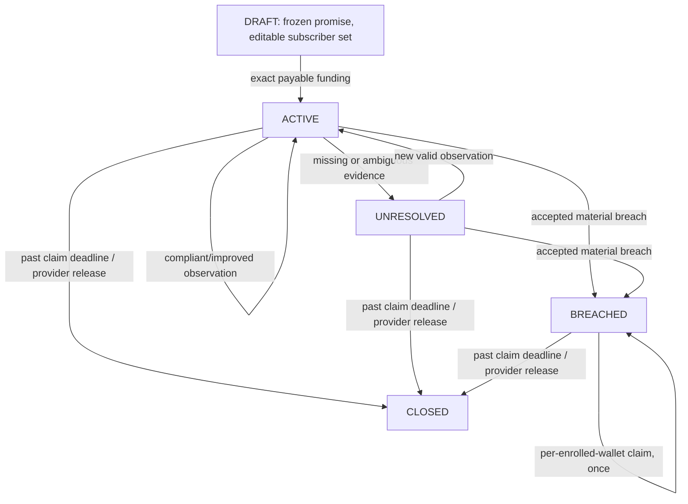

# Bermond V1 protocol specification

## Product boundary

Bermond is *a service assurance bond*, not an escrow marketplace, invoice reconciler or generalized Internet Court. Its primary actor is a provider that voluntarily puts financial collateral behind specifically frozen public service commitments. The consumer is a registered eligible beneficiary (including a software agent wallet). The protected artifact is a public service policy, not a delivery receipt.

## Trust model

- Provider chooses initial service, 4 frozen clauses, two canonical HTTPS URLs, baseline SHA256, per-subscriber payout and two deadlines.
- Baseline must be independently accessible and hash-matching during adjudication. The baseline hash is set at creation; funding cannot alter it.
- All source text, HTTPS content and prompted response fields are untrusted; URLs inside fetched documents are not followed.
- LLM outputs classify four dimensions only: allowance, retention, refunds and notice. All money and state calculations are deterministic.
- Provider selects subscribers *before funding*. A registered subscriber neither pays into nor guarantees the bond; enrolled wallets may collect one predetermined reward after accepted breach.

## Lifecycle

Every call to `check_policy` requires transaction time <= `coverage_ends`. The claim grace period is a later deadline, used for payout and returning unused funds. `BREACHED` is sticky; provider cannot use a subsequent benign policy revision to erase verified compensation rights. `CLOSED` cannot be paid or checked again.

## State / ABI

Public writes: `create_bond`, `enroll_subscriber`, `fund_bond` (payable), `check_policy`, `claim_compensation`, `release_collateral`.

Views: `get_bond`, `get_bond_ids`, `get_claim_status`.

A `Bond` stores: provider, service name/category, source references, four clauses, policy fingerprint, payout_wei, coverage_ends, claim_deadline, subscriber list, claimed list, remaining reserve, creation time, last assessment, last fingerprint, total checks and status.

## Financial invariants

1. Escrow amount equals `payout × frozen subscriber count` exactly. No partial funding.
2. `claim_compensation` pays `payout` to the transaction caller *only if* enrolled, not yet claimed, breach accepted, and within the claim deadline.
3. Claims update persistent state and decrease reserve **before** emitting a finalized native GEN transfer.
4. `release_collateral` is callable only by provider after claim deadline; transfers exactly remaining reserve.
5. `amount_claimed + amount_released + remaining_reserve = amount_funded` for each funded bond; no method can mint new reserve.
6. Unknown or malformed model output cannot select compensation amounts or recipients.

## Equivalence

Semantic classifications are normalized to ordered `(dimension, status)` pairs. Validator source evidence is independently fetched; the validator recomputes status and ignores harmless wording differences in prose or witness selection. Disagreement must not authorize compensation.

## Limits and liveness

Max 120 bonds and 12 subscribers per bond; four fixed dimensions; source text max 32,000 characters per URL; a baseline hash is mandatory. Coverage must end between one hour and 366 days after creation. Claim grace window is between 1 second and 90 days after coverage. **These are source-level checks subject to GenVM verification, not an assertion of deployed enforcement.**

## Known V1 limitations

- A dishonest publisher could manipulate the current URL or make it unavailable to deny monitoring; publisher identity and independent archive attestations require further integration.
- A breach must be discovered during coverage. Missing monitoring can lead to return of unused collateral after grace; do not market this as automatic monitoring.
- No provider-imposed consent proof for enrollment; beneficiaries should verify their eligibility with wallet signature as a planned enhancement.
- Direct Mode / Studio validation and a working onchain proof are mandatory before real-value usage.