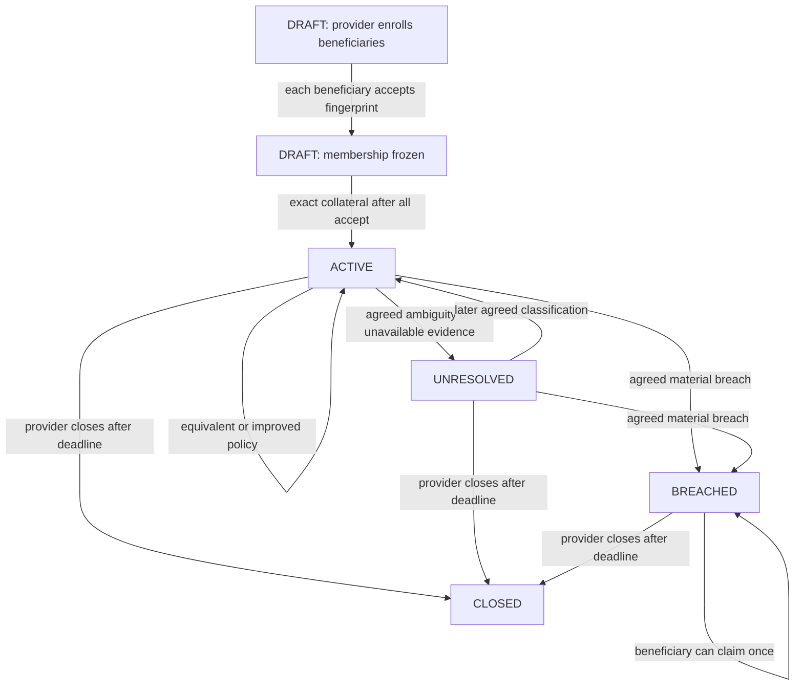

# Bermond protocol

## Scope and trust

Bermond is a voluntary collateral commitment by a service provider. It protects exactly four provider-authored dimensions: allowance, retention, refunds, and notice. The contract freezes the terms and evidence references for each bond, limits model output to classifications and findings, and calculates all recipients, amounts, and deadlines deterministically.

The baseline is identified by a provider-supplied document ID, publisher name, policy version, URL, and SHA-256. These values are committed in the bond fingerprint and shown to beneficiaries before acceptance. They establish what the provider promised in this bond; they do not authenticate the publisher, prove the document was historically published, or establish the publisher's legal authority. Current policy URLs are unauthenticated too. No central certifier is introduced.

All fetched content is untrusted data. Prompt instructions in a policy page are ignored. A resolved classification must cite exact bounded baseline and current excerpts whose full-document hashes match the independently fetched documents. Validator agreement binds the dimension, status, witness sources, normalized evidence quotations and digests, and normalized material factual premise. Style and punctuation in the fact summary do not affect the comparison. The model cannot create evidence, choose money, change state, or select a payment recipient.

## Lifecycle



The provider may enroll beneficiaries only in `DRAFT`, before the first beneficiary accepts. Every enrolled beneficiary must accept the current fingerprint before funding. The first acceptance freezes membership. Funding must equal the fixed payout multiplied by the frozen beneficiary count.

Anyone can submit `check_policy` during coverage while the bond is `ACTIVE` or `UNRESOLVED`. The contract does not monitor sources or schedule calls itself. A successfully finalized `UNRESOLVED` assessment is a stored non-paying result. A consensus transaction that fails or remains undecided is not an `UNRESOLVED` assessment and must not be presented as one.

`BREACHED` is sticky. A later policy improvement cannot erase already acquired beneficiary claim rights. Claims are permitted through the inclusive claim deadline. Release requires a later transaction strictly after that deadline and is provider-only.

## Public interface

Writes: `create_bond`, `enroll_subscriber`, `accept_bond`, `fund_bond` (payable), `check_policy`, `claim_compensation`, `release_collateral`.

Views: `get_bond`, `get_bond_ids`, `get_claim_status`.

The deployed source therefore has ten schema methods. Its required `py-genlayer` dependency remains pinned in the contract header. The earlier deployment has a different, nine-method schema and does not implement beneficiary acceptance or pending-transfer accounting.

## Financial accounting

For each funded bond, the candidate asserts:

```text
funded_wei = paid_wei + released_wei + reserved_wei + pending_wei
```

`reserved_wei` is the remaining amount still available under the contract's claim/release rules. A claim decrements the reserve and records a one-shot claimant before emitting a fixed transfer to that claimant. A provider release zeros the remaining reserve and closes the bond before emitting the transfer. Those outgoing GEN messages are recorded in `pending_wei`; they are not counted as paid or released because the Intelligent Contract has no authoritative settlement result available during execution.

There is no safe, documented standalone-contract reconciliation callback for an EOA transfer. The contract does not retry an ambiguous transfer or let an administrator mark it complete. Until GenLayer supplies an authoritative settlement guarantee or verifiable reconciliation path, `pending_wei` may remain unresolved indefinitely. This is a release blocker for production economic claims, not a guarantee that the beneficiary was paid.

Exact funding, per-bond reserves, caller authorization, one claim per enrolled beneficiary, closed-bond replay guards, fixed amounts, and deadline boundaries are enforced in contract code. Unit and Direct Mode checks cover these rules locally; live network behavior remains a separate gate.

## Constraints and liveness

The candidate bounds bond count, beneficiary count, document size, text length, payout, and term/grace durations in source. It accepts HTTPS URLs and rejects common private/local hostnames and literal IP-style hosts. It rejects a non-2xx response if the transport supplies an HTTP status, but the pinned Direct Mode `web.get` mock exposes only a body; non-2xx rejection is therefore not demonstrated for the target runner. The GenVM web API documentation does not establish a final URL field or redirect-blocking option, so DNS rebinding and redirects to untrusted origins remain unresolved risks. A hash mismatch fails closed to a non-paying result if consensus reaches agreement.

There is no autonomous monitor or keeper service. Beneficiaries, providers, or any other caller must notice policy changes and submit checks before coverage expires. An outage or missed check can allow the claim deadline to pass without a breach being recorded. No backend adjudicator is part of this product.

## Verification boundaries

- Fake-runtime tests validate contract logic and adversarial conditions without GenVM.
- GenLayer Direct Mode executes the contract with GenVM and mocked nondeterministic web/LLM responses. It is not network consensus.
- `genvm-lint check` runs the official linter and SDK semantic validation for the selected runtime family.
- Browser tests and type/build checks validate the frontend, not contract settlement.
- Studio deployment and finalized transaction receipts are separate evidence. The current source is deployed at `0xA42B4f4fB758A74B65b48faddB9ec92Af58158d0` on chain `61997` with exact source-byte parity. Live equivalent, unavailable-evidence, and breach checks reached accepted consensus; the breach claim finalized and a beneficiary balance delta was observed. The transfer remains represented as pending in contract accounting because no authoritative settlement reconciliation path exists. Improved-policy, current-deployment expiry release, partial-claim, and replay scenarios remain unverified.
